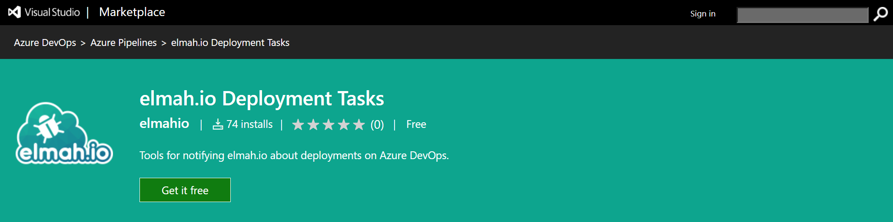
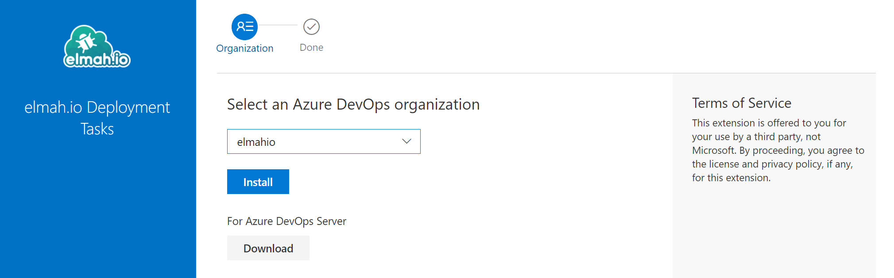
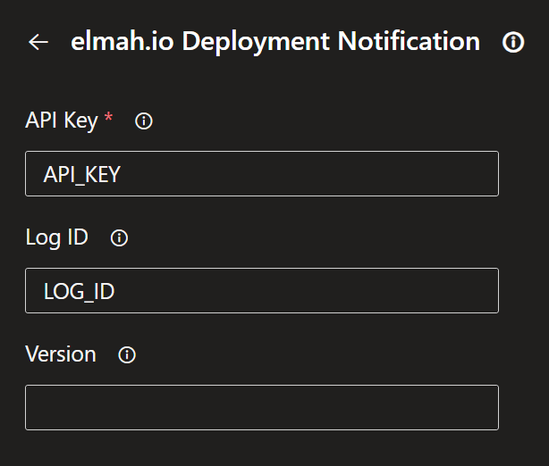

# elmah.io Deployment Notification

This extension tells [elmah.io](https://elmah.io) when you deploy from Azure DevOps. With deployments tracked, elmah.io shows how many warnings and errors each version produces, so you can tell whether a release made things better or worse.

The task works in YAML pipelines and classic release pipelines, on Windows, Linux, and macOS agents.

## Installation

Open the [elmah.io Deployment Tasks](https://marketplace.visualstudio.com/items?itemName=elmahio.deploy-tasks) extension on the Azure DevOps Marketplace and click *Get it free*:



Select your organization and click *Install*:



## Before you start

You need:

- An API key ([Where is my API key?](https://docs.elmah.io/where-is-my-api-key/)) with the `deployments_write` permission ([How to configure API key permissions](https://docs.elmah.io/how-to-configure-api-key-permissions/)).
- A log ID ([Where is my log ID?](https://docs.elmah.io/where-is-my-log-id/)) if the deployment belongs to a single log. Without a log ID, the deployment shows on all logs in the organization.
- An agent running version 3.232.1 or newer. Microsoft-hosted agents already do.

## YAML pipelines

Add the task as the last step of your deployment job:

```yaml
steps:
# other steps
- task: ElmahIoDeploymentNotification@5
  inputs:
    apiKey: 'API_KEY'
    logId: 'LOG_ID'
```

You can also add the task from the assistant. Click *Show assistant*, search for 'elmah.io deploy', and select the *elmah.io Deployment Notification* task:



Store the API key as a secret pipeline variable and reference it as `$(ElmahIoApiKey)` instead of writing it into the YAML.

## Classic release pipelines

Add the *elmah.io Deployment Notification* task to your release pipeline, choose task version 5.*, and fill in the fields:


## Inputs

| Input | Required | Description |
|-------|----------|-------------|
| `apiKey` | Yes | An elmah.io API key with the `deployments_write` permission. |
| `logId` | No | The ID of the log the deployment belongs to. Leave it empty to show the deployment on all logs. |
| `version` | No | The version name shown on elmah.io. Defaults to the build number (`BUILD_BUILDNUMBER`) in pipelines and the release name (`RELEASE_RELEASENAME`) in releases. |

Along with the version, the task sends the commit message and the commit author's name and email from pipelines, and the release description and the name of the person who requested the release from releases.

## Upgrading from version 4

Change `ElmahIoDeploymentNotification@4` to `ElmahIoDeploymentNotification@5`, or pick task version 5.* in a release pipeline. Version 4 does not run on Linux agents. Version 5 runs on Windows, Linux, and macOS agents and requires agent 3.232.1 or newer. The inputs are the same.

Version 5 fails the step if elmah.io can't be reached or rejects the request, for example because of an invalid API key. The error message from elmah.io is shown in the step log.
